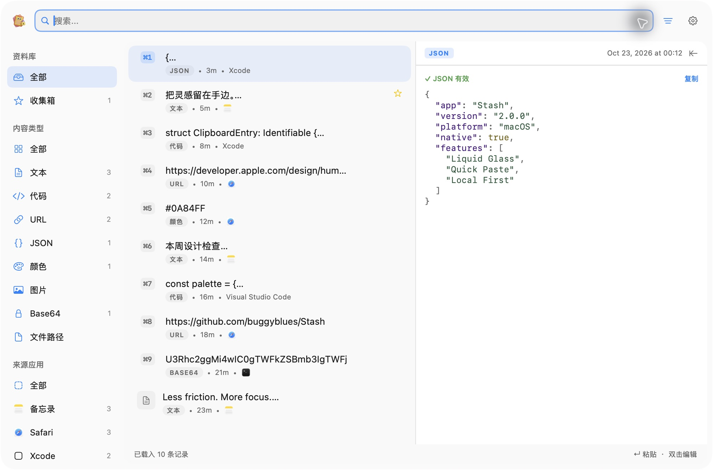

# Stash 2.0

原生 macOS 剪贴板管理器。使用 Swift、SwiftUI 和 AppKit 构建，以搜索、键盘操作和清晰的内容预览为中心。

**Swift 版是唯一受支持的主版本。Electron 1.x 已废弃，历史快照保留在 [legacy/electron](legacy/electron/README.md)，不再构建或发布。**

## 下载

- [Apple Silicon 安装包](https://release.zyb.world/Stash/releases/v2.0.1/Stash-2.0.1-arm64.dmg)
- [Intel 安装包](https://release.zyb.world/Stash/releases/v2.0.1/Stash-2.0.1-x64.dmg)
- [GitHub Releases](https://github.com/buggyblues/Stash/releases/latest)

macOS 12 及以上；macOS 26 及以上使用系统 Liquid Glass，旧系统使用原生 Vibrancy 材质。

## 功能

- 记录文本、图片、代码、URL、JSON、颜色、Base64 与文件路径。
- 搜索历史，按内容类型、来源应用、收藏和标签筛选。
- 中央分栏、右侧面板与底部卡片三种布局。
- 通过全局快捷键唤起面板；支持快速粘贴、序列队列和批量粘贴。
- 查看格式化 JSON、语法高亮代码、图片与颜色，双击快速编辑内容。
- 原生设置侧栏、深浅色外观与桌面小组件。
- SQLite 本地存储，可选 iCloud Drive 同步。跨应用粘贴需授予辅助功能权限。

2.0 不提供模板、密码保险库、Touch ID 或 TOTP 功能。

## 界面



[查看其他布局截图](docs/screenshots/2.0.0/README.md) 与 [2.0.1 设置页](docs/screenshots/2.0.1/settings-dark.png)。设置页可通过右上角关闭按钮或 ⌘W 关闭。截图使用隔离的合成演示数据。

## 开发

安装 Swift 6.2+ 和 macOS SDK 26+ 后（以编译完整的 Liquid Glass 支持）：

```bash
make test
make build
make run
```

`make build` 产物为 `swift/build/Stash.app`。`make run` 启动使用独立应用标识和数据目录的 `Stash-QA.app`，避免开发签名覆盖正式版的辅助功能授权。公开发布使用 Developer ID 签名和 Apple 公证。

三语文案以 `swift/Resources/Locales/*.json` 为唯一来源，执行 `make locales` 更新 Swift 生成表。

## 构建与发布

GitHub Actions 调度两类执行器：Mac mini 运行无桌面依赖的测试，GitHub macOS 26 执行器运行完整测试并生成 Apple Silicon / Intel 原生安装包。`v2.*` 标签触发签名、公证、GitHub Release 和 COS/CDN 发布。

详见 [发布流程](docs/releasing.md)、[2.0.0 变更](docs/releases/2.0.0.md) 和 [2.0.1 修复](docs/releases/2.0.1.md)。网站介绍和截图同样只对应 Swift 新版。

## 许可证

[AGPL-3.0](LICENSE)。
